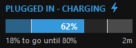
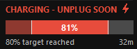
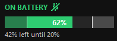
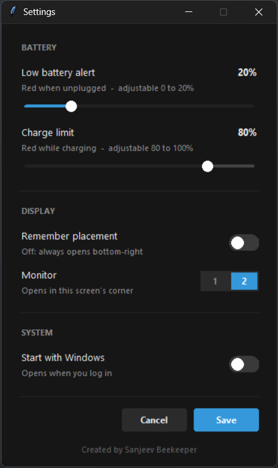
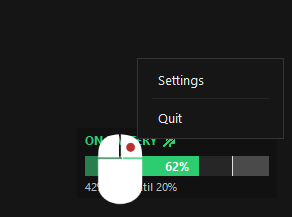

# Battery Widget (Lite)

The free Lite edition of a tiny always-on-top battery overlay for Windows. It shows whether you are plugged in, a charging
progress bar, and turns red when you cross your own limits, so you remember to unplug at 80%
and recharge before the battery runs low.

## Screenshots

| Charging                                                                                           | Charge limit reached                                                                                       | On battery                                                                                     |
|:--------------------------------------------------------------------------------------------------:|:----------------------------------------------------------------------------------------------------------:|:----------------------------------------------------------------------------------------------:|
|  |  |  |

| Settings                                                                                        | Right-click menu                                                                                             |
|:-----------------------------------------------------------------------------------------------:|:------------------------------------------------------------------------------------------------------------:|
|  |  |

## Features

- Charging / on-battery status with a small icon
- Progress bar split into three zones (low alert, normal, charge limit) with 1px markers
- Turns red when charging past your charge limit, or on battery below your low alert
- "X% to go until 80%" while charging, "X% left until 20%" on battery
- Charging timer (for example `20m`)
- Settings window (right-click the widget):
  - Low battery alert (0-20%) and charge limit (80-100%) sliders
  - Remember placement, or always open at the bottom-right above the taskbar
  - Choose which monitor to use (shown only when 2 or more screens are connected)
  - Start with Windows
- Drag to move. Single instance: a second copy closes itself.

## Lite and Pro

|                                               | Lite (this repo) | Pro         |
| --------------------------------------------- |:----------------:|:-----------:|
| Charging status, progress bar and timer       | Yes              | Yes         |
| Custom low alert and charge limit             | Yes              | Yes         |
| Placement, monitor choice, start with Windows | Yes              | Yes         |
| Themes and animation packs                    | -                | Coming soon |
| In-app update check                           | -                | Coming soon |
| Company licence and deployment support        | -                | Yes         |
| Priority support                              | -                | Yes         |

Interested in Pro or a company licence? Contact:  sanjeevramanathan@proton.me

## How it works

**Reading the battery.** Every 2 seconds the widget asks Windows for the battery level and whether the
charger is connected (through the `psutil` library). It does not use the network and does not send or
store any data about you.

**Colours and messages.**

| Situation                                       | Colour | Status text                              |
| ----------------------------------------------- | ------ | ---------------------------------------- |
| Plugged in and charging, below the charge limit | Blue   | PLUGGED IN - CHARGING                    |
| Plugged in and at or above the charge limit     | Red    | CHARGING - UNPLUG SOON                   |
| On battery, above the low alert                 | Green  | ON BATTERY                               |
| On battery and at or below the low alert        | Red    | LOW 18% - RECHARGE (shows the current %) |

**The progress bar.** The bar runs from 0 to 100% and is divided into three zones by two thin markers:
the low alert (default 20%) and the charge limit (default 80%). The middle zone is filled in the full
colour. The outer zones are filled in a faded version of the same colour, so you can see at a glance
when the battery is outside your preferred range.

**The two text lines.**

- Top: the status and an icon (a lightning bolt while charging, an unplugged plug on battery).
- Bottom left: how far you are from your limit, either "X% to go until 80%" while charging or
  "X% left until 20%" on battery.
- Bottom right: how long it has been charging. The timer counts from the moment the widget saw the
  charger connect. If you start the widget while already plugged in, it counts from when the widget started.

**Your limits.** The low alert can be set from 0 to 20% and the charge limit from 80 to 100%, so the two
can never cross. The sliders will not move into the greyed-out part of the track.

**Placement.**

- *Remember placement on:* the widget reopens wherever you last dropped it. If that spot is on a screen
  that is no longer connected, it falls back to the corner of your chosen monitor.
- *Remember placement off:* it always opens at the bottom-right of the chosen monitor, just above the taskbar.
- The monitor picker only works when placement is not remembered, because a remembered position already
  decides the screen.

**Start with Windows.** Turning this on adds a per-user entry that launches the widget at login. It is
removed again when you turn the switch off.

**What it cannot do.** The widget only reminds you. It does not stop your laptop from charging. If your laptop
maker offers a charge limit setting (for example a "battery conservation" mode), that can enforce the limit for you.

## Requirements

- Windows 10 or 11
- Python 3.9 or newer (with Tkinter, included in the standard Windows installer)
- A laptop with a battery

## Run it

```
pip install -r requirements.txt
python battery_widget.py
```

Use `pythonw battery_widget.py` to run without a console window.

## Build a single .exe

```
pip install pyinstaller
pyinstaller --onefile --noconsole --icon=battery.ico --name BatteryWidget battery_widget.py
```

The file is created at `dist\BatteryWidget.exe`. Windows SmartScreen may warn about an unsigned app:
choose **More info**, then **Run anyway**.

## Where settings are stored

`%APPDATA%\BatteryWidget\settings.json` holds your limits, monitor, placement and the
remember-placement choice. Delete it to return to the defaults.
"Start with Windows" uses a per-user entry under
`HKCU\Software\Microsoft\Windows\CurrentVersion\Run`.

## Defaults

Edit the values at the top of `battery_widget.py` (`HIGH_LIMIT`, `LOW_LIMIT`, `MONITOR`, `WIDTH`, `HEIGHT`).

## License

Released under the [PolyForm Noncommercial License 1.0.0](LICENSE). You may use, change and share it for noncommercial purposes. Commercial use, including use inside a company, requires the Pro licence.

---

Created by Sanjeev Beekeeper
